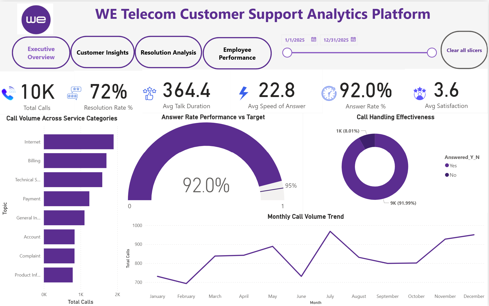
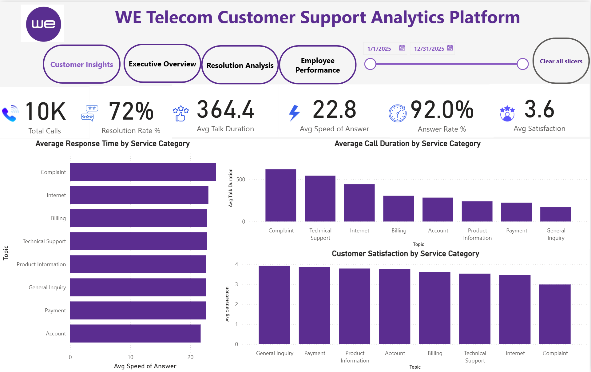
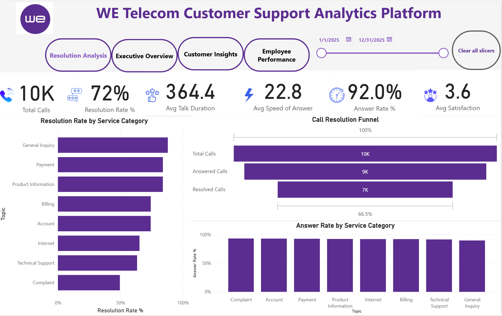
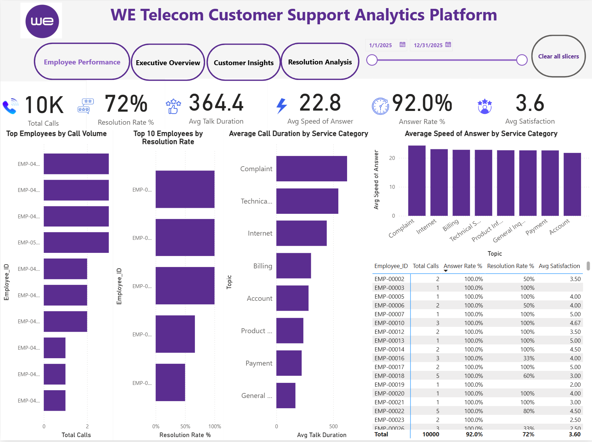

# WE Telecom Customer Support Analytics Platform

An interactive Power BI project designed to analyze telecom customer support operations, monitor service performance, and identify opportunities to improve call resolution and customer satisfaction.

## Project Overview

This project presents a four-page customer support analytics dashboard with key performance indicators and service-level analysis. It enables users to explore call volume, response time, resolution performance, customer satisfaction, and employee metrics over a selected reporting period.

**Project type:** Data Analytics | Business Intelligence | Power BI

## Business Objectives

- Monitor overall call center performance.
- Evaluate call answering and resolution rates.
- Identify service categories with longer response and talk durations.
- Analyze customer satisfaction across service categories.
- Compare employee workloads and resolution performance.
- Support data-driven operational improvement.

## Dashboard Pages

### 1. Executive Overview

Provides a high-level summary of key performance indicators, including total calls, resolution rate, average talk duration, average speed of answer, answer rate, and average satisfaction.

### 2. Customer Insights

Analyzes response times, call durations, and customer satisfaction across service categories.

### 3. Resolution Analysis

Examines resolution rates by service category, the call resolution funnel, and answer rates.

### 4. Employee Performance

Explores employee call volumes, resolution rates, service-category metrics, and employee performance details.

## Key Performance Indicators

| KPI | Business Purpose |
|---|---|
| Total Calls | Measures total call volume |
| Resolution Rate | Tracks the percentage of calls resolved |
| Average Talk Duration | Measures average call handling time |
| Average Speed of Answer | Evaluates how quickly calls are answered |
| Answer Rate | Measures the proportion of calls answered |
| Average Satisfaction | Summarizes customer satisfaction scores |

## Tools & Technologies

- Microsoft Power BI
- Data Visualization
- KPI Reporting
- Interactive Filtering and Date Slicers
- DAX and Data Modeling, where applicable

## Repository Contents

- `Telecom_Customer_Support_Analytics.pbix` — Power BI report.
- `executive-overview.png` — Executive Overview screenshot.
- `customer-insights.png` — Customer Insights screenshot.
- `resolution-analysis.png` — Resolution Analysis screenshot.
- `employee-performance.png` — Employee Performance screenshot.

## How to Explore the Project

1. Download the `.pbix` report from this repository.
2. Open it in Microsoft Power BI Desktop.
3. Navigate through the four report pages.
4. Use the available date slicers and filters to explore the dashboard.

## Analytical Considerations

- Review KPI definitions and calculation logic before making business decisions.
- Compare resolution rates with call volume and customer satisfaction.
- Interpret differences between service categories as observed patterns, not proof of causation.

## Data Disclaimer

This repository is a portfolio project. The dashboard should not be interpreted as an official internal WE Telecom reporting system. The data source and any usage restrictions should be documented accurately before publication.

## Author

**Mohannad Mohsen**  
Computer Science Student | Aspiring Data Analyst

- GitHub: [mohanadnoby](https://github.com/mohanadnoby)
- LinkedIn: Add your LinkedIn profile URL here

---

If you find this project useful, feel free to explore the report and its dashboard screenshots.
